<p align="center">
  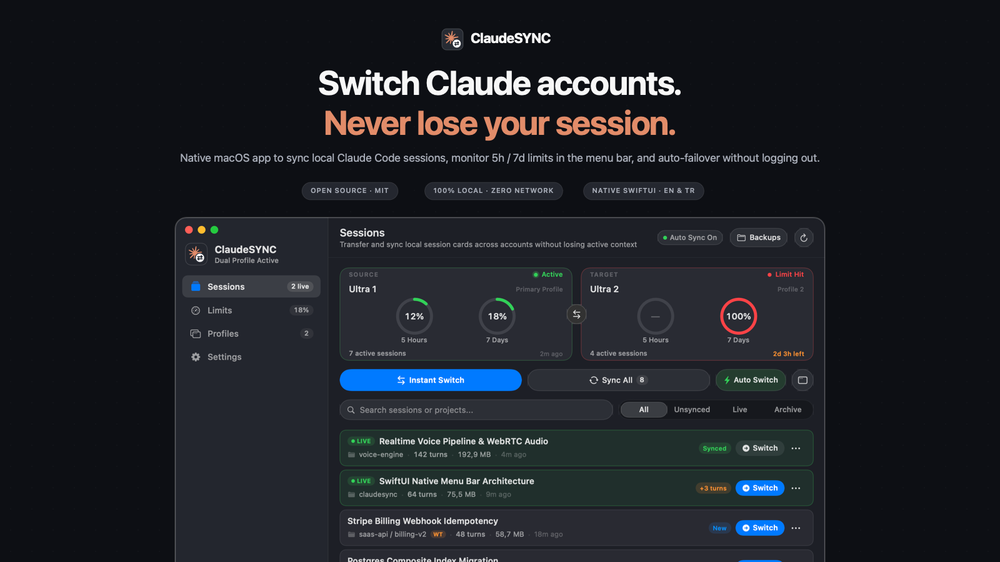
</p>

<p align="center">
  <a href="https://github.com/berkayildize/ClaudeSYNC/releases/latest">
    
  </a>
  
  
  <a href="LICENSE">
    
  </a>
</p>

# ClaudeSYNC

**Switch Claude Code Desktop accounts without logging out — and never lose your active session context.**

A native, 100% local, open-source macOS desktop app (with a toggleable Retina Menu Bar widget, guided first-launch setup wizard, and full English & Turkish localization) built for developers running multiple Claude accounts who want live 5-hour / 7-day limit tracking, zero-logout switching, and seamless session continuity.

---

## Feature Overview

<p align="center">
  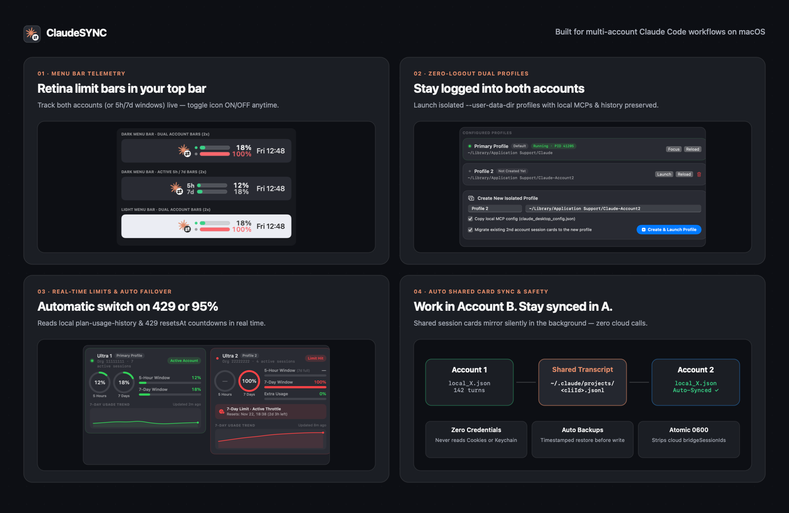
</p>

- **Full macOS Desktop App + Toggleable Menu Bar Widget**
  - Manage sessions, live limits, isolated profiles, and settings from a clean 2-column native macOS window — and toggle the top Menu Bar icon **ON or OFF** anytime (`⌘⇧M`).
- **Guided First-Launch Setup Wizard & Bilingual UI (English / Türkçe)**
  - Walks new users through language selection (System Auto, English, Turkish), local Claude Desktop folder & notification permission verification, optional 2nd profile setup, and menu bar preferences in under 60 seconds.
- **Live Retina Menu Bar Limit Bars**
  - Custom flat-vector ClaudeSYNC icon + crisp `@2x` stacked progress bars directly in the macOS Menu Bar displaying both accounts' usage (or active account's `5h / 7d` windows), tuned for both Dark and Light menu bars.
- **Zero-Logout Dual-Profile Mode (`--user-data-dir`)**
  - Launch an isolated secondary Claude Desktop profile in one click (optionally copying your local `claude_desktop_config.json` MCP servers and existing session cards — never cookies or tokens). Stay signed into both accounts permanently.
- **Real-Time Limits & Automatic Failover**
  - Monitors local `plan-usage-history.json` and active `.jsonl` tails for `429 usage_limit_reached` events and exact `resetsAt` countdowns. Automatically transfers active sessions to your healthy account and brings its profile forward when a limit hits.
- **Background Auto Shared-Card Sync**
  - Once you share a session across accounts and continue working in Account B, ClaudeSYNC silently mirrors updated card metadata (`completedTurns`, `title`, `lastActivityAt`) back to Account A — never touching unshared sessions and never overwriting newer state with older state.
- **100% Local & Safe by Design**
  - Zero network calls. Zero telemetry. No Accessibility, Screen Recording, or Keychain permissions required. Never reads `Cookies` or OAuth tokens.
  - Creates timestamped backups before every write (`~/Library/Application Support/ClaudeSYNC/backups/`).
  - Strips account-bound `bridgeSessionIds` & `remoteMcpServersConfig`, cleans archive/deleted tombstones, and writes atomically with `0600` POSIX permissions.

---

## Guided Setup Wizard (60-Second First Launch)

<p align="center">
  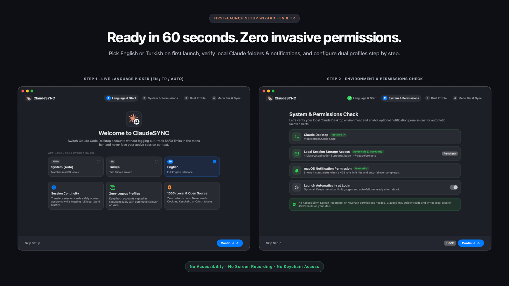
</p>

---

## How It Works

<p align="center">
  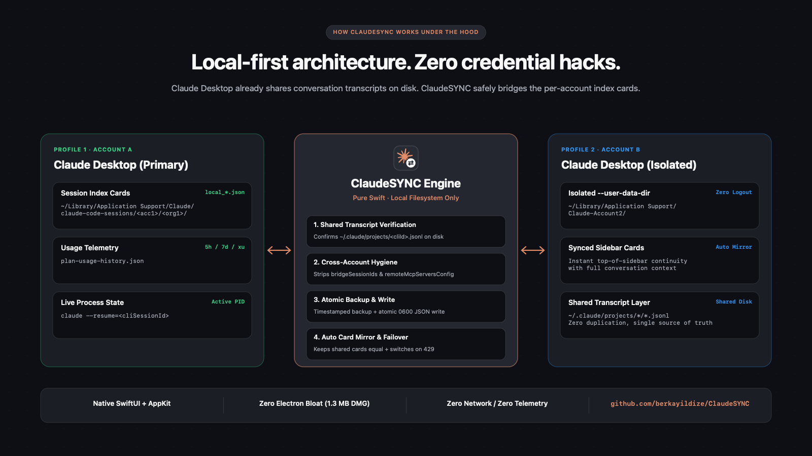
</p>

When using **Claude Desktop's Code tab** with multiple accounts:

1. **Conversation transcripts (`.jsonl`) are already shared locally** under `~/.claude/projects/`.
2. **Only the sidebar session index cards (`local_*.json`) are isolated per account** under `~/Library/Application Support/Claude/claude-code-sessions/<accountUuid>/<orgUuid>/`.

ClaudeSYNC bridges those local session cards safely so switching profiles preserves your entire conversation, code edits, and tool history on disk.

---

## Native Dark & Light Design (0.0% Idle CPU)

<p align="center">
  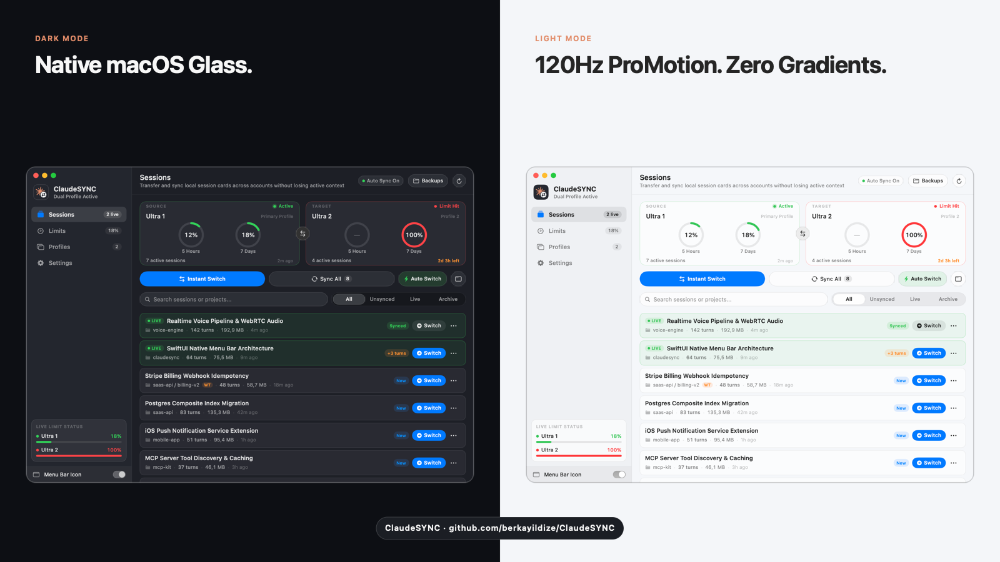
</p>

<details>
<summary><strong>More App Screenshots (Sessions, Limits, Profiles, Settings, Onboarding, Popover)</strong></summary>

| Sessions Workspace | Limits & Auto-Failover |
| :---: | :---: |
| 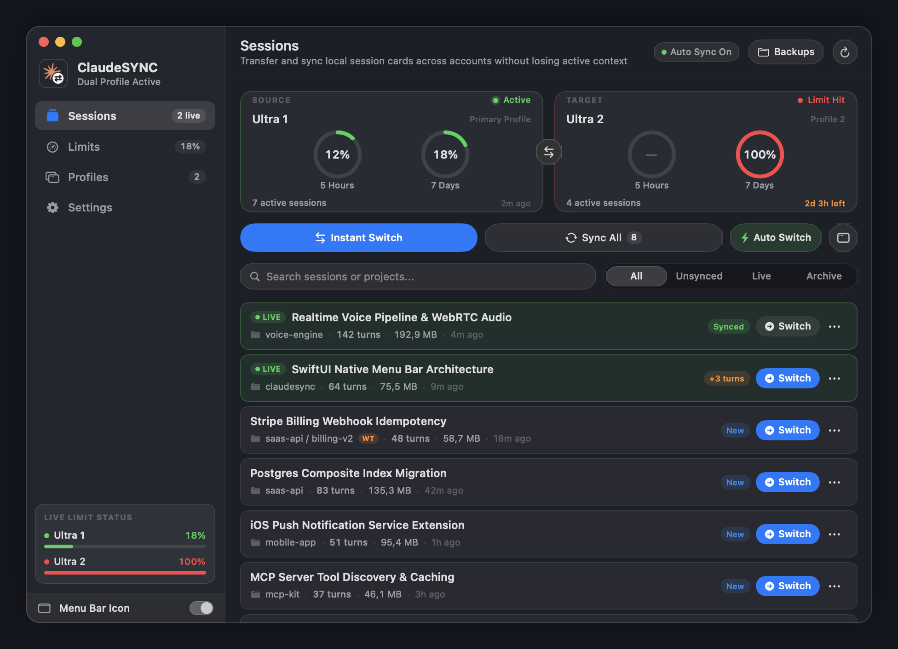 | 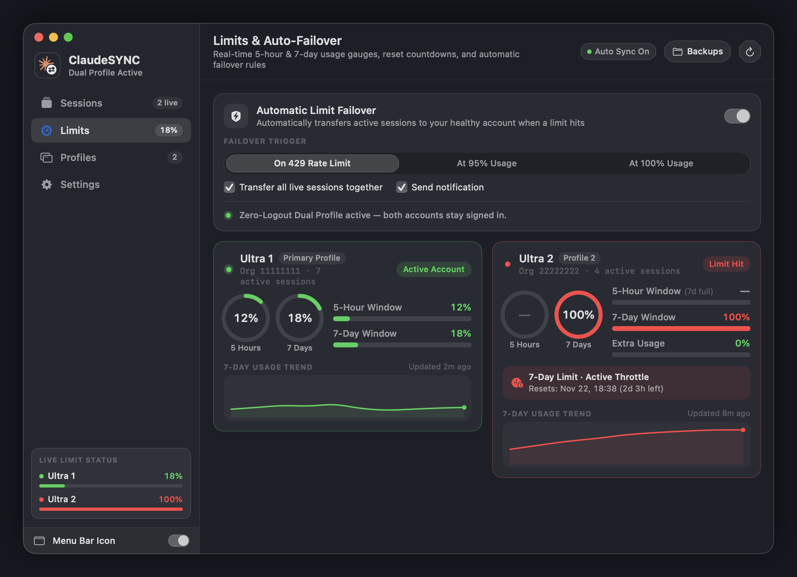 |

| Dual Profiles Manager | Menu Bar Popover |
| :---: | :---: |
| 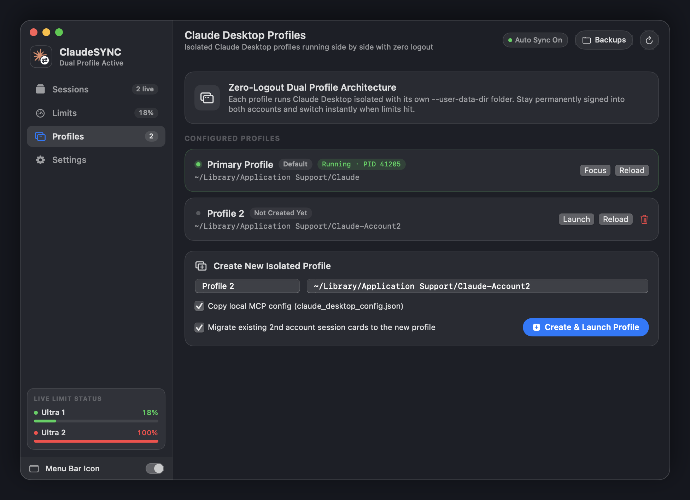 | 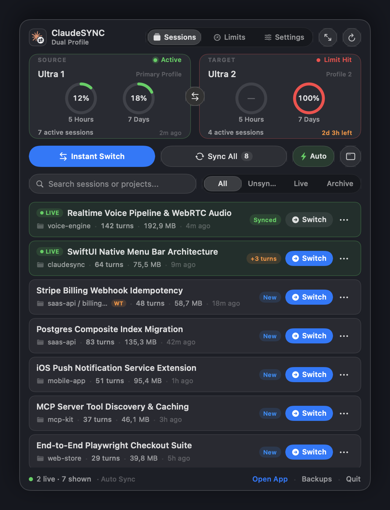 |

| Menu Bar Styles (Dark & Light) | Settings (EN & TR) |
| :---: | :---: |
| 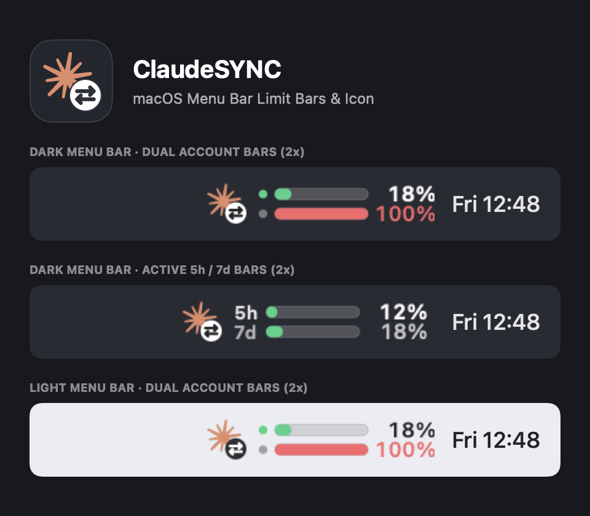 | 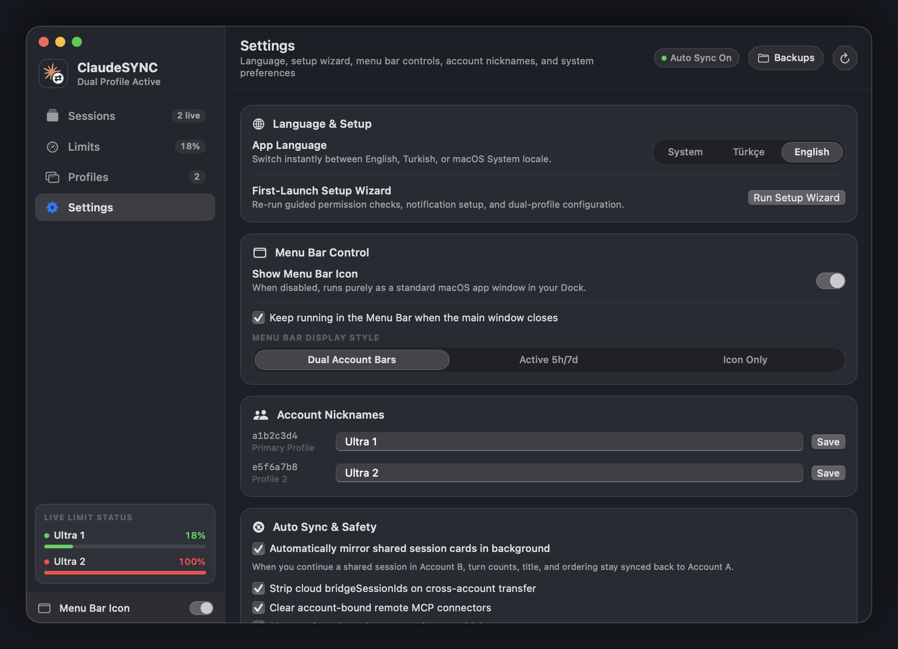 |

</details>

---

## Installation

### Option 1: Download Prebuilt DMG (Recommended)

1. Download **`ClaudeSYNC-v1.0.0-macOS.dmg`** from [**GitHub Releases**](https://github.com/berkayildize/ClaudeSYNC/releases/latest).
2. Drag **`ClaudeSYNC.app`** into your **`Applications`** folder.
3. Because this is an unsigned open-source release, right-click `ClaudeSYNC.app` → **Open** on first launch, or clear quarantine:
   ```bash
   xattr -dr com.apple.quarantine /Applications/ClaudeSYNC.app
   ```

### Option 2: Build from Source

Requires **macOS 14.0+** and **Xcode Command Line Tools** (`swift` 5.10+).

```bash
git clone https://github.com/berkayildize/ClaudeSYNC.git
cd ClaudeSYNC

# Run the unit test suite
swift test

# Build Release .app bundle and install into /Applications
bash scripts/build-app.sh --install

# Optional: also package a distributable DMG in dist/
bash scripts/build-app.sh --dmg
```

---

## Good to Know

- **Extended Thinking blocks across organizations:** Anthropic cryptographically binds extended thinking blocks to the organization that created them. When resuming a transferred session under a second account, your **full conversation history, code edits, and tool outputs are preserved**, while prior signed thinking blocks are safely skipped on the first resumed turn.
- **Avoid concurrent writes to the same session:** Do not send prompts to the exact same session simultaneously in two open Claude Desktop windows, as both append to the same local `.jsonl` file.

---

## Project Structure

```text
ClaudeSYNC/
├── Sources/
│   ├── ClaudeSYNCCore/     # Pure Swift discovery, sync engine, 429 tail watcher, process monitor
│   └── ClaudeSYNC/         # AppKit shell + SwiftUI Desktop App, Setup Wizard, L10n (EN/TR), @2x Menu Bar renderer
├── Tests/
│   └── ClaudeSYNCTests/    # Isolated unit test suite (zero mutation of live user data)
├── docs/assets/            # Synthetic demo screenshots & architecture diagrams
└── scripts/
    ├── build-app.sh        # Release .app bundle + optional --install and --dmg
    ├── generate-icon.swift # Vector CoreGraphics AppIcon.icns generator
    └── generate-launch-kit.swift # Bilingual (EN + TR) promo visuals & 1080p60 launch video generator
```

---

## License

MIT — see [LICENSE](LICENSE).

> **Disclaimer:** ClaudeSYNC is an independent, community-built open-source utility and is not affiliated with or endorsed by Anthropic.
